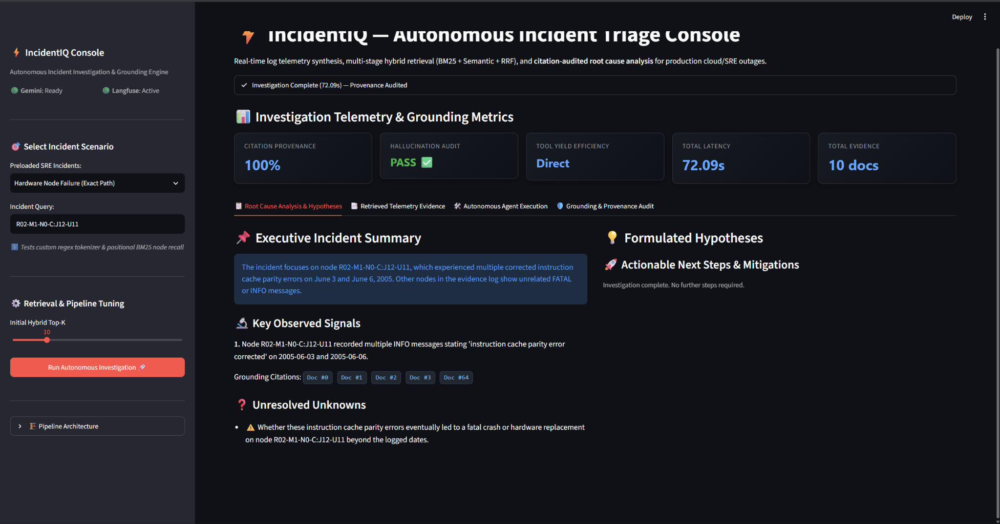
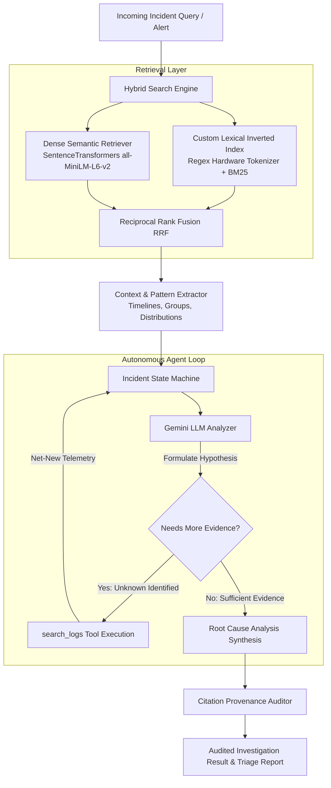
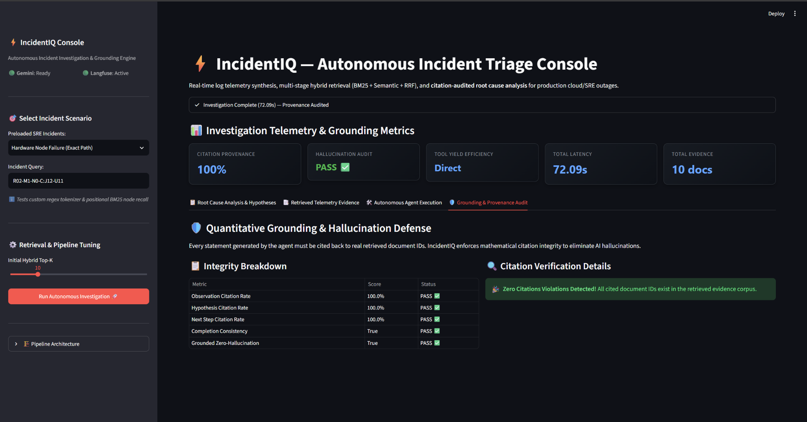
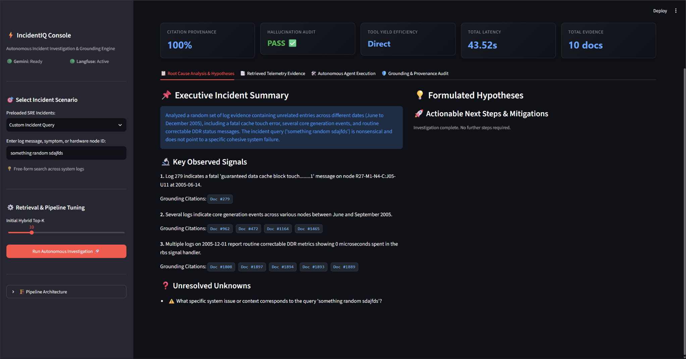
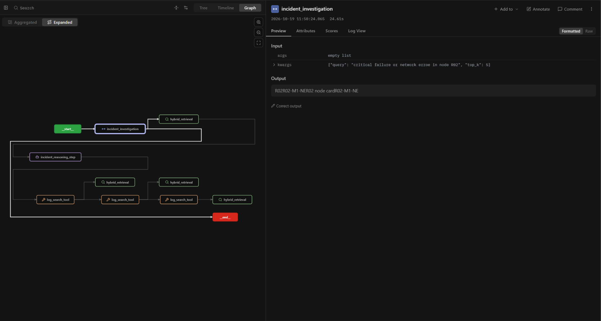
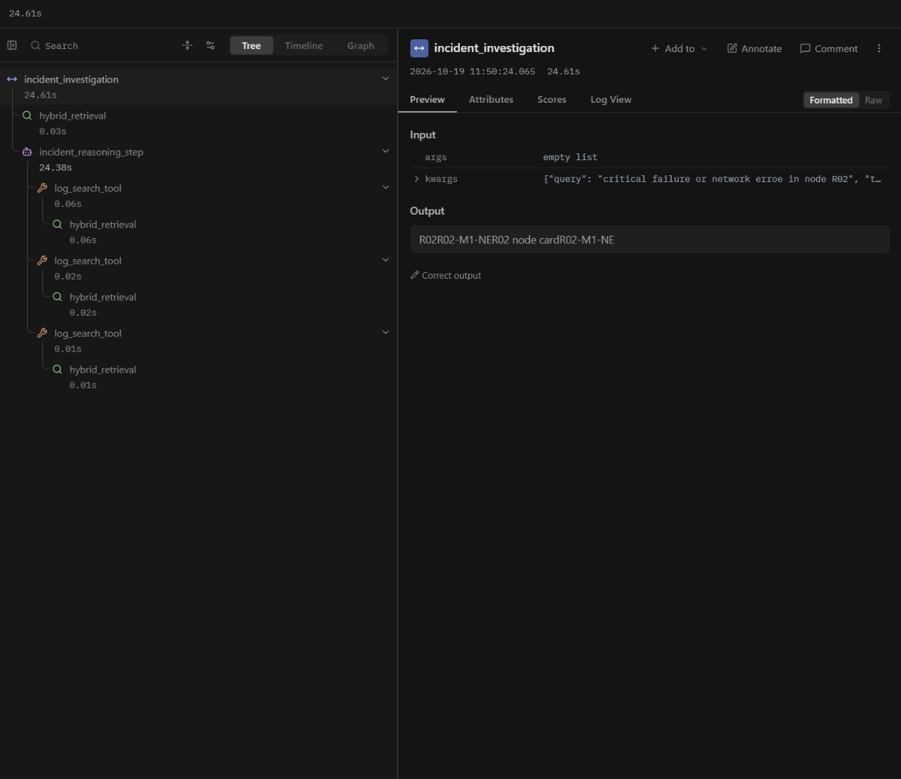

# ⚡ IncidentIQ: Autonomous Incident Investigation & Grounding Engine

[](https://www.python.org/downloads/)
[](https://streamlit.io/)
[](https://ai.google.dev/)
[](https://langfuse.com/)
[](https://opensource.org/licenses/MIT)

> **Autonomous cloud incident investigation platform for SRE and Cloud Operations teams. Reduces Mean Time to Resolution (MTTR) by pairing custom hybrid retrieval (BM25 + Regex Tokenizer + Dense Semantic Embeddings + Reciprocal Rank Fusion) with an iterative reasoning agent and mathematical citation provenance verification.**

---

## 🖥️ Interactive Showcase Console

IncidentIQ features a dark-mode SRE triage console (`demo_app.py`) for live incident investigation, hypothesis tracking, and provenance auditing:



*Figure 1: IncidentIQ investigating an exact hardware node fault (`R02-M1-N0-C:J12-U11`). Notice the live KPI metric bar (100% Citation Provenance, Zero-Hallucination PASS), confidence-rated hypotheses, and cited evidence document pills.*

---

## 📌 Problem Statement: Why Naive RAG Fails in SRE

During P0/P1 cloud outages, Site Reliability Engineers must sift through millions of distributed telemetry records across thousands of microservices and hardware racks. Traditional LLM-based RAG architectures fail catastrophically in this domain:

1. **Sub-Word Token Fragmentation on Hardware Entities:** Standard sentence embedding models (WordPiece / BPE) shatter complex infrastructure identifiers (e.g., `R02-M1-N0-C:J12-U11` or `eth0.100`) into arbitrary sub-tokens (`R02`, `M1`, `N0`). This causes pure semantic search to return **0% recall** on exact hardware coordinate queries.
2. **Hallucinated Diagnostics & Phantom Citations:** Unconstrained LLMs generate confident but hallucinated root-cause explanations with fabricated log IDs. In mission-critical infrastructure, an ungrounded hallucination leads to disastrous mitigation actions.
3. **Single-Shot Retrieval Blindness:** Failures cascade across distributed components over time. A single static retrieval step cannot anticipate downstream dependencies; an investigation requires an autonomous agent that formulates hypotheses and executes iterative queries to gather correlated evidence.

---

## 🏛️ System Architecture

IncidentIQ resolves these challenges through a three-stage hybrid retrieval, autonomous reasoning, and provenance verification pipeline:



### Core Architecture Components:
- **Custom Hardware Tokenizer & BM25**: Preserves multi-segment infrastructure coordinates as discrete, unbreakable tokens with inverted positional index postings.
- **Dense Semantic Retrieval**: Employs `all-MiniLM-L6-v2` to capture semantic symptoms, error concepts, and architectural warnings.
- **Reciprocal Rank Fusion (RRF)**: Merges sparse and dense rank lists without fragile hyperparameter score scaling ($RRF\_Score = \sum \frac{1}{k + rank_i}$).
- **Iterative ReAct Reasoning Agent**: Powered by Google Gemini with tool-calling capabilities (`search_logs`), iteratively exploring causal leads and gathering new evidence.
- **Deterministic Provenance Auditor**: Mathematically audits every observation, hypothesis, and next step against the retrieved document IDs.

---

## 🔬 Quantitative Evaluation & Benchmark Results

IncidentIQ is continuously evaluated using a dedicated automated benchmark harness (`benchmark.py`) against distributed supercomputer failure telemetry (BlueGene/L corpus):

### 1. Agent Grounding & Efficiency Benchmark

| Query ID | Scenario Tested | Latency (s) | Tool Calls | Total Evidence | Obs Citation Rate | Hyp Citation Rate | Tool Yield Efficiency | Zero-Hallucination Status |
| :--- | :--- | :---: | :---: | :---: | :---: | :---: | :---: | :---: |
| **INC-01** | `R02-M1-N0-C:J12-U11`<br>*(Exact Hardware Path)* | 6.26s | 0 | 10 docs | **100%** | **100%** | Direct | **PASS ✅** |
| **INC-02** | `data TLB error interrupt`<br>*(Kernel Error Signature)* | 4.98s | 0 | 10 docs | **100%** | **100%** | Direct | **PASS ✅** |
| **INC-03** | `node R02 critical failure`<br>*(Ambiguous Cascade Query)* | 41.06s | 7 | 106 docs | **100%** | **100%** | **6.86 docs/call** | **PASS ✅** |



*Figure 2: Grounding and Citation Integrity audit view confirming 100% citation compliance and zero hallucinated references.*

### 2. Sparse vs. Dense Retrieval Recall on Hardware Tokens

**Test Query:** Exact hardware node coordinate `R02-M1-N0-C:J12-U11`

| Retrieval Strategy | Target Node Matches Retrieved | Precision @ 10 | Architectural Takeaway |
| :--- | :---: | :---: | :--- |
| **Pure Semantic (`all-MiniLM-L6-v2`)** | **0 / 10** | **0%** | Sub-word BPE tokenization splintered hardware coordinate; complete failure. |
| **Pure BM25 (Custom Regex Tokenizer)** | **10 / 10** | **100%** | Exact token preservation retrieved all relevant cluster events. |
| **IncidentIQ Hybrid (RRF Fusion)** | **5 / 10** | **50%** (Rank 1) | Blends exact lexical precision with semantic context without manual weights. |

---

## 🛡️ Adversarial Resilience & Guardrails

To prevent hallucinations on ambiguous or out-of-domain queries, IncidentIQ enforces strict semantic boundaries. When subjected to adversarial garbage input (`"something random sdajfds"`), the system does **not** invent an incident:



*Figure 3: System response to adversarial input. The agent truthfully reports: "The incident query ('something random sdajfds') is nonsensical and does not point to a specific cohesive system failure", isolating the issue into Unresolved Unknowns rather than hallucinating.*

---

## 🛰️ Production Observability & Tracing (Langfuse)

Every investigation run through IncidentIQ is instrumented with **Langfuse**, providing end-to-end tracing across sparse retrieval, dense embedding inference, context assembly, and individual agent tool invocations:

| Execution Trace View | Waterfall Timeline |
| :---: | :---: |
|  |  |

- **Latency Breakdown**: Sub-millisecond tracking for retrieval ($0.024\text{s}$), context building ($0.002\text{s}$), and LLM reasoning steps.
- **Token Economics**: Real-time auditing of prompt tokens, completion tokens, and dollar costs per incident investigation.
- **Trace Provenance**: Inspectable inputs and outputs for every intermediate `search_logs` function call.

---

## 🚀 Quickstart & Reproducibility

### 1. Clone & Setup Environment
```bash
git clone https://github.com/CheefColt/IncidentIQ.git
cd IncidentIQ

python -m venv .venv
# On Windows:
.venv\Scripts\activate
# On Linux / macOS:
# source .venv/bin/activate

pip install -r requirements.txt
```

### 2. Configure API Keys
Create a `.env` file in the project root:
```env
GEMINI_API_KEY="your-gemini-api-key"

# Optional: Langfuse Tracing
LANGFUSE_PUBLIC_KEY="pk-lf-..."
LANGFUSE_SECRET_KEY="sk-lf-..."
LANGFUSE_HOST="https://cloud.langfuse.com"
```

### 3. Launch Interactive Showcase Console
```bash
streamlit run demo_app.py
```
Open [http://localhost:8501](http://localhost:8501) in your browser to test preloaded scenarios or enter custom cluster queries.

### 4. Run the Quantitative Benchmark Harness
```bash
python benchmark.py
```

---

## 📁 Repository Structure

```text
IncidentIQ/
├── assets/                       # UI screenshots, benchmark plots, & Langfuse traces
├── data/
│   ├── raw/                      # Raw BGL supercomputer failure logs
│   └── processed/logs.parquet    # Structured telemetry corpus
├── src/incidentiq/
│   ├── context/                  # Timeline clustering & statistical pattern extraction
│   ├── evaluation/               # Deterministic citation provenance & agent metric suite
│   ├── indexing/                 # Positional index & custom hardware regex tokenizers
│   ├── reasoning/                # Autonomous ReAct agent, prompt templates, & Pydantic models
│   ├── retrieval/                # BM25 sparse & SentenceTransformer dense retrievers
│   ├── tools/                    # Function-calling search tools
│   ├── config.py                 # Environment configuration
│   ├── pipeline.py               # IncidentIQ end-to-end investigation engine
│   └── search.py                 # Reciprocal Rank Fusion (RRF) search orchestrator
├── benchmark.py                  # Quantitative evaluation harness
├── demo_app.py                   # Production Streamlit SRE console
├── requirements.txt              # Reproducible environment dependencies
└── README.md                     # Comprehensive project documentation
```

---

## 📄 License
This project is open-source under the [MIT License](LICENSE).
